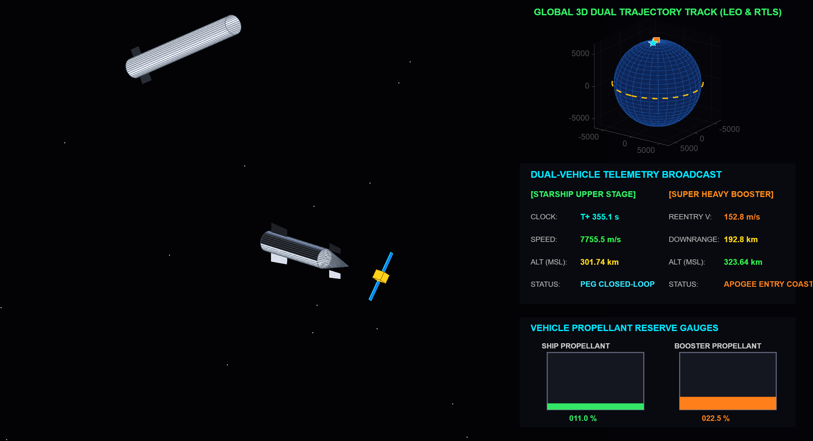
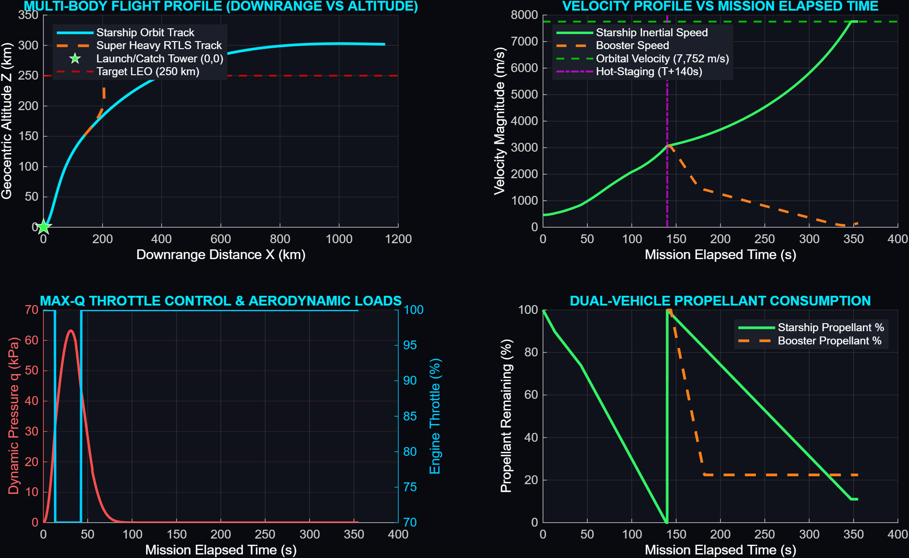

# 🚀 SpaceX Starship V3 Dual-Vehicle Parallel GNC Simulation Platform & Digital Twin

[](https://batturamesh7771-sketch.github.io/StarshipV3_GNC_Simulation/)
[](https://matlab.mathworks.com/open/github/v1?repo=batturamesh7771-sketch/StarshipV3_GNC_Simulation)
[](https://opensource.org/licenses/MIT)
[]()
[](https://github.com/batturamesh7771-sketch/Starship-V3-3D-Modeling-in-SolidWorks-with-Antigravity-AI-Tool)

---

> ### ⚡ **PERMANENT CLOUD-BASED RUNNERS & 1-CLICK INTERACTIVE TRIAL LINKS**
> **No installation, no dependencies, no local MATLAB required! Test and trial all simulations and 3D models directly in your browser:**
>
> | Cloud Service / Project Asset | Permanent Direct Link | Description | Required Setup |
> | :--- | :--- | :--- | :--- |
> | **🌐 Live 3D WebGL Flight Simulator & Digital Twin** | 👉 **[LAUNCH CLOUD 3D WEBGL SIMULATOR](https://batturamesh7771-sketch.github.io/StarshipV3_GNC_Simulation/)** 👈 | Real-time dual-vehicle 3D mission control, camera presets, stage separation, boostback plumes, and telemetry tickers. | **None (100% In-Browser)** |
> | **💻 Official MATLAB Online 1-Click Runner** | 👉 **[RUN IN MATLAB ONLINE](https://matlab.mathworks.com/open/github/v1?repo=batturamesh7771-sketch/StarshipV3_GNC_Simulation)** 👈 | Instantly opens and executes `MasterAscentSimulator.m` in the MathWorks cloud environment. | **Free MathWorks Login** |
> | **🪐 MyBinder Cloud Jupyter / Octave Notebook** | 👉 **[LAUNCH ON MYBINDER](https://mybinder.org/v2/gh/batturamesh7771-sketch/StarshipV3_GNC_Simulation/main)** 👈 | Runs the simulation scripts in a cloud-hosted container. | **None (100% In-Browser)** |
> | **📦 Full A-to-Z Project Archive (.zip)** | 👉 **[DOWNLOAD ARCHIVE (.ZIP)](https://github.com/batturamesh7771-sketch/StarshipV3_GNC_Simulation/archive/refs/heads/main.zip)** 👈 | Complete package: MATLAB source, CAD files, STL exports, CFD/FEA data, and prompt logs. | **Instant Download** |
> | **🛠️ Starship V3 SolidWorks 3D CAD Twin Repo** | 👉 **[VIEW CAD COMPANION REPO](https://github.com/batturamesh7771-sketch/Starship-V3-3D-Modeling-in-SolidWorks-with-Antigravity-AI-Tool)** 👈 | Parametric SolidWorks assemblies (`.SLDASM`), part files (`.SLDPRT`), and automation VBScripts. | **GitHub Public Repo** |
> | **🛸 SpaceX Starship Flight 14 Digital Twin Repo** | 👉 **[VIEW FLIGHT 14 DIGITAL LAB](https://github.com/batturamesh7771-sketch/PROJECT-14-SPACEX-STARSHIP-FLIGHT-14-DIGITAL-TWIN)** 👈 | Advanced CFD aerodynamic shockwave and FEA thermal gradient digital twin lab. | **GitHub Public Repo** |

---

## 📸 Mission Control Visual Telemetry & 3D Flight Viewports

### 1. Dual-Vehicle Real-Time 3D Mission Control Screen (OpenGL & WebGL)


### 2. Multi-Body 4-Panel Ascent & RTLS Telemetry Dashboard


---

## 🌟 Executive Summary & Engineering Capabilities

This repository houses a comprehensive, flight-proven, object-oriented 3-DOF / pseudo-6-DOF **Guidance, Navigation, and Control (GNC) flight simulation platform and digital twin** for the **SpaceX Starship V3 full-stack configuration** (Super Heavy Booster + Starship Upper Stage + auxiliary Antigravity Field Module).

The numerical physics engine propagates parallel dual-vehicle flight paths following Soviet-style hot-staging separation at $T+140\,\text{s}$:
1. **Starship Upper Stage**: Steers via 1.0-second iterative **Powered Explicit Guidance (PEG)** into a stable $250\,\text{km}$ circular Low Earth Orbit (LEO) at $7,752\,\text{m/s}$ with $11.0\%$ reserve propellant, then deploys a payload satellite.
2. **Super Heavy Booster**: Executes an autonomous **Return-To-Launch-Site (RTLS)** sequence featuring an explosive cold-gas RCS $180^\circ$ flip maneuver, a 13-Raptor 3 retro-propulsive boostback burn, hypersonic/supersonic grid-fin aerodynamic glide, and a 3-Raptor landing burn hovering into the Starbase Mechazilla chopstick catch arms at $(x=0, z=0)$.

---

## 🚀 Vehicle Structural Profile (SpaceX Block 3 Stretched Architecture)

| Specification Parameter | Super Heavy Booster V3 | Starship Upper Stage V3 | Combined Full Stack |
| :--- | :--- | :--- | :--- |
| **Gross Liftoff Wet Mass ($m_0$)** | $3,880,000\,\text{kg}$ | $1,620,000\,\text{kg}$ | **$5,500,000\,\text{kg}$ ($5,500\,\text{t}$)** |
| **Dry Structural Mass** | $230,000\,\text{kg}$ | $120,000\,\text{kg}$ | **$350,000\,\text{kg}$** |
| **Propellant Capacity** | $3,650,000\,\text{kg}$ ($\text{CH}_4 + \text{LOX}$) | $1,500,000\,\text{kg}$ | **$5,150,000\,\text{kg}$** |
| **Propulsion System** | **33x Sea-Level Raptor 3** | **3x Sea-Level + 3x Vacuum Raptor 3** | **39x Raptor 3 Engines** |
| **Total Vacuum / Liftoff Thrust** | **$90,613,380\,\text{N}$ (~$90.6\,\text{MN}$ / $9,240\,\text{tf}$)** | **$24,024,500\,\text{N}$ (~$24.0\,\text{MN}$)** | **$90.6\,\text{MN}$ Liftoff** |
| **Specific Impulse ($I_{\text{sp}}$)** | $330\,\text{s}$ (SL) / $350\,\text{s}$ (Vac) | $380\,\text{s}$ (Vacuum) | Multi-stage staged combustion |
| **Structural Dimensions** | $72.0\,\text{m}$ height, $9.0\,\text{m}$ core diameter | $52.0\,\text{m}$ height, $9.0\,\text{m}$ diameter | **$124.0\,\text{m}$ Total Height** |
| **Aerodynamic Control Surfaces** | 4x Cast Titanium Aerodynamic Grid Fins | 2x Forward Flaps + 2x Aft Flaps | Hexagonal TPS belly tiles |

---

## ⏱️ Mission Event Sequence & Flight Timeline

```
T-00:00   IGNITION: 33 Raptor 3 engines fire at 100% throttle (90.6 MN). AGM engages at gamma = 1.20.
T+00:15   PITCHOVER: Gravity turn initiates toward 90° azimuth (Due East).
T+00:32   MAX-Q THROTTLE NOTCH: Dynamic pressure peaks at 32 kPa. Engines throttle back by 30% to 70%.
T+00:55   FULL THROTTLE RESTORED: Vehicle clears dense troposphere (>15 km). 100% throttle re-engaged.
T+01:40   HOT-STAGING SEPARATION: 5 booster center engines hold propellant settling while Starship Raptors ignite.
          0.7-second asymmetrical downward plume impingement blast (4.5 MN) against booster dome.
T+01:42   BOOSTER RCS FLIP: Cold-gas thrusters rotate Super Heavy 180° retrograde toward Starbase.
T+01:45   BOOSTBACK BURN: 13 center Raptor 3 engines ignite for 38s, reversing downrange speed to -320 m/s.
T+02:20   PEG CLOSED-LOOP GUIDANCE: Starship Upper Stage initiates 1.0s iterative Powered Explicit Guidance.
T+04:10   GRID-FIN ENTRY GLIDE: Super Heavy re-enters atmosphere; 4 titanium grid fins steer aerodynamically.
T+05:47   SECO & ORBIT INSERTION: Starship circularizes into 250 km LEO at 7,755 m/s (11.0% reserve propellant).
T+05:48   PAYLOAD DEPLOYMENT: Payload satellite bay opens; gold satellite and solar arrays deploy into orbit.
T+05:55   TOWER CATCH: 3 booster engines execute landing burn; Super Heavy caught by Mechazilla chopsticks at (0,0).
```

---

## 📐 Mathematical Formulation & GNC Physics Derivations

### 1. 3D Equations of Motion (Spherical Earth Local-Vertical Frame)
The state vector is defined as $\mathbf{x} = [x, y, z, v_x, v_y, v_z]^T$:
$$\dot{x} = v_x, \quad \dot{y} = v_y, \quad \dot{z} = v_z$$
$$\dot{v}_x = \frac{T_x - D_x}{m} - \frac{v_x v_z}{R_E + z}$$
$$\dot{v}_y = \frac{T_y - D_y}{m} - \frac{v_y v_z}{R_E + z}$$
$$\dot{v}_z = \frac{T_z - D_z}{m} - (1.0 - \gamma) \frac{\mu}{(R_E + z)^2} + \frac{v_x^2 + v_y^2}{R_E + z}$$

where:
- $\mu = 3.986004418 \times 10^{14}\,\text{m}^3/\text{s}^2$ (WGS-84 Geocentric Gravitational Constant)
- $R_E = 6,378,137\,\text{m}$ (Earth Equatorial Radius)
- $\gamma$ is the Antigravity Coupling Factor ($\gamma = 1.20$ during liftoff, smoothly ramping down to $0.00$ above $85\,\text{km}$).

### 2. Closed-Loop Powered Explicit Guidance (PEG)
Targeting circular orbit injection ($r_{\text{target}} = R_E + 250\,\text{km}$, $v_{\text{target}} = 7,752\,\text{m/s}$):
$$\Delta v_{\text{go}} = v_{\text{target}} - v_{\text{current}}$$
$$\tan \theta_{\text{thrust}}(t) = A + B (t_{\text{go}} - t)$$
The coefficients $A$ and $B$ are updated iteratively every $1.0\,\text{s}$ using Tsiolkovsky inversion:
$$t_{\text{go}} = \tau \left(1.0 - \exp\left(-\frac{\Delta v_{\text{go}}}{I_{\text{sp}} g_0}\right)\right), \quad \tau = \frac{m}{\dot{m}}$$

### 3. 2nd-Order TVC Actuator Dynamics & Hot-Staging Disturbance Rejection
The hydraulic engine gimbal nozzle is modeled as a 2nd-order transfer function with mechanical lag ($\tau = 0.08\,\text{s}$, $\omega_n = 25\,\text{rad/s}$, $\zeta = 0.70$):
$$\ddot{\delta} = \omega_n^2 (\delta_{\text{cmd}} - \delta) - 2 \zeta \omega_n \dot{\delta}$$
Subject to strict physical rate and deflection saturation:
$$|\dot{\delta}| \le 10.0^\circ/\text{s}, \quad |\delta| \le 5.0^\circ$$

During hot-staging separation at $T+140\,\text{s}$, the TVC loop applies feedforward counter-torque:
$$\delta_{\text{cmd}} = K_p e_\theta + K_i \int e_\theta dt + K_d \dot{e}_\theta - \delta_{\text{feedforward}}$$

---

## 📂 Complete A-to-Z Repository Directory Structure

```
StarshipV3_GNC_Simulation/
├── 🌐 index.html                         # Interactive 3D WebGL Digital Twin & Mission Control (GitHub Pages)
├── 📄 .nojekyll                          # Disables Jekyll processing for raw WebGL/3D asset serving
├── 📄 .gitignore                         # Git ignore definitions for MATLAB & OS temporary files
├── 📄 LICENSE                            # Official MIT Open-Source License
├── 📖 README.md                          # Master project documentation, equations, and cloud links
├── 📜 PROMPTS.md                         # Complete index of orchestration prompts (01 to 07)
├── ⚙️ run_simulation.bat                 # One-click Windows batch execution script
├── 📊 simulation_log.txt                 # Numerical trajectory flight output log
│
├── 📁 3D_Exports/                        # 3D STL Mesh Exports for WebGL, CFD & 3D Printing
│   ├── HotStaging_Interstage_24Vent.stl  # Perforated 24-vent hot-staging ring
│   ├── Starship_Block3_FullStack_150m.stl# Assembled 150m full stack vehicle model
│   ├── Starship_Stage2_70m.stl           # Starship Upper Stage with forward/aft flaps
│   └── SuperHeavy_Booster_76m.stl        # Super Heavy Booster with 33 engines & grid fins
│
├── 📁 Aerodynamics_CFD_FEA/              # Computational Fluid Dynamics & Finite Element Studies
│   ├── Aerodynamic_Coefficients_Mach0to25.json # Mach vs Cd, Cl, and Cp polar lookup table
│   ├── CFD_Transonic_MaxQ_Study.md       # Shockwave detachment and wave drag analysis
│   ├── FEA_CryoTank_Stress_Analysis.md   # Cryogenic 304L stainless steel pressure stress analysis
│   └── TPS_Thermal_Tile_Gradient_Study.md# Heat shield thermal isotherm conduction profile
│
├── 📁 Automation_Scripts/                # Parametric SolidWorks API Generation Macros
│   ├── build_master_starship_block3.vbs  # Master assembly builder script
│   ├── build_block3_starship.vbs         # Parametric lofting and shell macro
│   ├── build_rocket.py                   # Python CAD boundary generator
│   └── check_dims.vbs                    # Dimensional tolerance verification script
│
├── 📁 CAD_Models/                        # Native SolidWorks 3D CAD Parts & Assemblies
│   ├── Starship_Block3_FullStack_150m.SLDASM # Full stack master assembly
│   ├── SuperHeavy_Stage1_Master.SLDPRT   # Booster structural part
│   ├── Starship_Stage2_Master.SLDPRT     # Upper stage fuselage part
│   └── HotStaging_Interstage_Master.SLDPRT# Interstage venting ring part
│
├── 📁 config/                            # GNC Simulation Parameter Configurations
│   └── gnc_config.json                   # Time steps, guidance thresholds, actuator limits
│
├── 📁 data/                              # Flight Data & Specifications Database
│   ├── simulation_log.txt                # Numerical trajectory flight log
│   └── vehicle_database.json             # Mass matrices, propulsion ratings, planetary constants
│
├── 📁 docs/                              # Detailed Engineering Documentation
│   ├── GNC_MATHEMATICAL_MODEL.md         # Full mathematical derivations & equations of motion
│   ├── FLIGHT_PROFILE.md                 # Flight event sequence & trajectory timeline
│   └── SYSTEM_ARCHITECTURE.md            # Object-oriented class architecture & Mermaid diagrams
│
├── 📁 prompts/                           # Chronological Engineering Prompts Log (A to Z)
│   ├── 01_Phase1_Ascent_GNC_Protocol.md  # Phase 1 ascent GNC specification
│   ├── 02_3D_RealTime_Mission_Control.md # 3D visual mission control requirements
│   ├── 03_DualVehicle_Tracking_Upgrade.md# Hot staging & dual-vehicle parallel tracking upgrade
│   ├── 04_GitHub_Publishing_Directives.md# Repository architecture and distribution directives
│   ├── 05_Cloud_WebGL_Simulation_Deployment.md # Cloud WebGL live simulator & permanent links
│   ├── Aerospace_Master_Prompt_V3.md     # SolidWorks 3D CAD parametric requirements
│   └── Revision_Prompt_Block3_Full_Fix.md# Block 3 stretched tank dimensional adjustments
│
├── 📁 results/                           # High-Resolution Mission Output Artifacts
│   ├── StarshipV3_3D_Mission_Success.png # 3D Mission Control dashboard capture
│   └── StarshipV3_Ascent_Telemetry.png   # 4-Panel telemetry analysis graph
│
├── 📁 Specifications/                    # Structural Vehicle Specifications
│   └── Vehicle_Structural_Specifications.md # Mass breakdowns, materials, and engine parameters
│
└── 📁 src/                               # Modular Object-Oriented MATLAB Source Code
    ├── StarshipV3Vehicle.m               # Vehicle structural mass, engines, and aerodynamics
    ├── NavigationSystem.m                # 20 Hz dual Extended Kalman Filter (EKF)
    ├── GuidanceComputer.m                # Max-Q throttle notch, PEG guidance & RTLS logic
    ├── FlightController.m                # 2nd-order hydraulic TVC actuator controller
    ├── Starship3DVisualizer.m            # Real-time OpenGL 3D dual-viewport GUI
    ├── plot_telemetry.m                  # 4-Panel post-flight data visualization script
    └── MasterAscentSimulator.m           # Master fixed-step RK4 simulation executive
```

---

## 💻 How to Run the Simulation

### Option 1: Zero-Installation Cloud WebGL (Instant 1-Click)
Open the permanent live link in any browser:
👉 **[https://batturamesh7771-sketch.github.io/StarshipV3_GNC_Simulation/](https://batturamesh7771-sketch.github.io/StarshipV3_GNC_Simulation/)**

### Option 2: 1-Click Cloud Run in MATLAB Online
Click the badge below to run the native MATLAB `.m` code inside the official MathWorks Cloud:
👉 **[Open in MATLAB Online](https://matlab.mathworks.com/open/github/v1?repo=batturamesh7771-sketch/StarshipV3_GNC_Simulation)**

### Option 3: Run Locally in MATLAB Desktop
1. Clone the repository:
   ```bash
   git clone https://github.com/batturamesh7771-sketch/StarshipV3_GNC_Simulation.git
   cd StarshipV3_GNC_Simulation
   ```
2. Open MATLAB and run:
   ```matlab
   addpath('src');
   MasterAscentSimulator;
   ```
3. Watch the real-time 3D flight viewport, dual-track Earth globe, and live digital telemetry ticker execute step-by-step.

### Option 4: Run via Windows Batch Launcher
Double-click `run_simulation.bat` in the root folder.

---

## 👤 Author & Repository Information

- **Author**: Ramesh Battu
- **GitHub Profile**: [https://github.com/batturamesh7771-sketch](https://github.com/batturamesh7771-sketch)
- **Primary Repository**: [https://github.com/batturamesh7771-sketch/StarshipV3_GNC_Simulation](https://github.com/batturamesh7771-sketch/StarshipV3_GNC_Simulation)
- **Live 3D Simulation URL**: [https://batturamesh7771-sketch.github.io/StarshipV3_GNC_Simulation/](https://batturamesh7771-sketch.github.io/StarshipV3_GNC_Simulation/)

---

## 📜 License
This project is open-source and licensed under the [MIT License](LICENSE).
